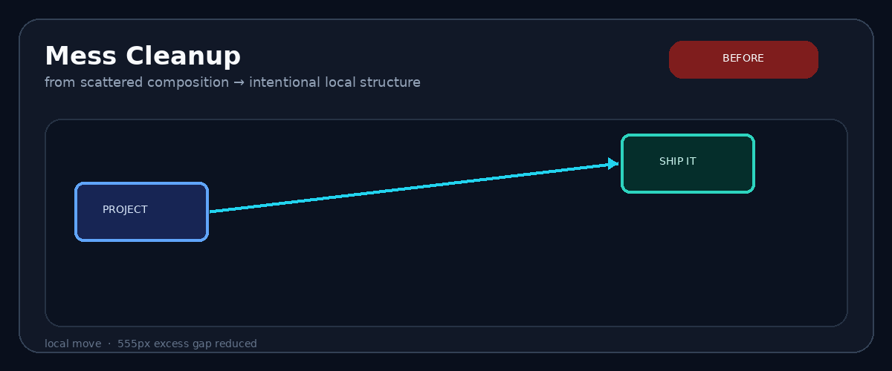
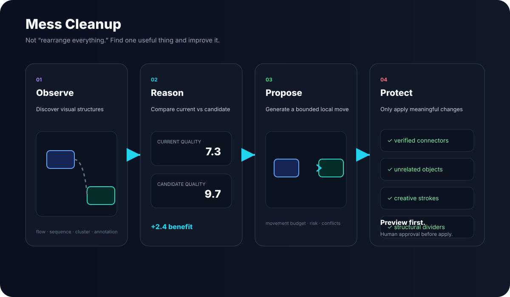
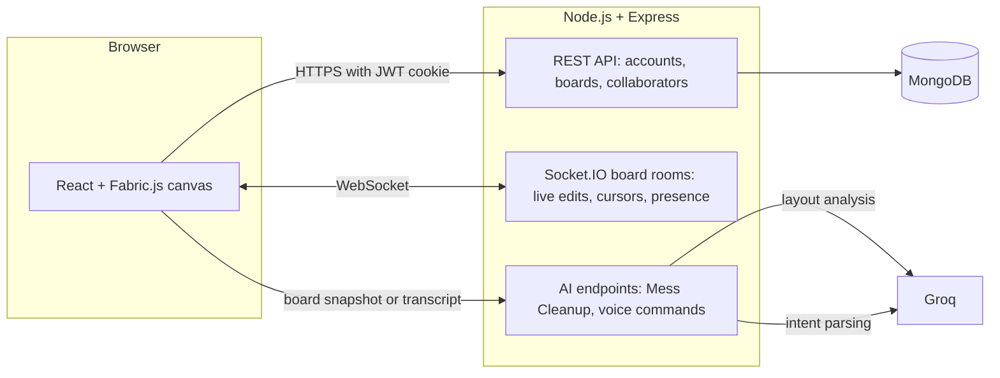

<div align="center">



<br />
<br />


<a href="#what-you-can-do">Features</a>&nbsp;&nbsp;&nbsp;&nbsp;<a href="#mess-cleanup">Mess Cleanup</a>&nbsp;&nbsp;&nbsp;&nbsp;<a href="#voice">Voice</a>&nbsp;&nbsp;&nbsp;&nbsp;<a href="#how-it-works">How it works</a>&nbsp;&nbsp;&nbsp;&nbsp;<a href="#run-it-locally">Run it locally</a>

</div>

<br />

Skribe is an infinite whiteboard for teams. Everyone on a board sees the same canvas, live: strokes as they are drawn, cursors, selections and a laser pointer. When the board gets messy, **Mess Cleanup** suggests a tidier layout that you preview before anything moves. And when talking is faster than typing, **voice dictation and voice commands** put words, notes and shapes on the board for you.

## What you can do

<table>
<tr>
<td width="50%" valign="top">

### Draw and organise

- Pen, eraser, pan and zoom on an infinite canvas
- Sticky notes in four colours, plus callout notes
- Rectangles, rounded rectangles, circles, triangles, diamonds and hexagons, each with an editable label
- Straight, elbow and curved connectors, with dashed, dotted and two-way styles
- Text, undo and redo, and a properties panel for fill, border and typography

</td>
<td width="50%" valign="top">

### Work together, live

- Boards you share with the collaborators you invite
- Live object edits, drawing strokes and erasing
- Named cursors, shared selections and a laser pointer for presenting
- Presence as people join and leave
- Autosave, including your viewport, so a board reopens where you left it

</td>
</tr>
</table>

## Mess Cleanup

<div align="center">
  
</div>

<br />

Press **Clean up** and Skribe reads the board the way a teammate would. It sends the board's objects and a snapshot of the canvas to Groq (`qwen/qwen3.8-27b`), which identifies flows, groups and annotations. Skribe then proposes the smallest local change that makes the board clearer. You see a preview first, and nothing moves until you apply it.

| It improves | It never |
| --- | --- |
| Alignment and spacing inside a group | Invents connections between objects |
| Empty space between related items | Rearranges the whole board |
| Readability of flows, branches and merges | Moves freehand sketches or dividers |
| Labels that drifted away from their shapes | Touches objects outside the change |

<div align="center">
  
</div>

## Voice

<div align="center">
  
</div>

<br />

Open the microphone in the toolbar and pick a mode.

- **Dictation** turns speech into text you can edit, then inserts it on the board.
- **Command** turns an instruction into an object. Try "Create a sticky note saying Ideas", "Create a pink note with dark blue text saying Design" or "Create a blue rectangle labelled Planning".

Commands create text, sticky notes and the six basic shapes, with optional note, fill and text colours. Unstyled notes get a light default with dark text, and unreadable colour pairs are adjusted so labels stay legible. The server sends each instruction to Groq (`openai/gpt-oss-20b`), which returns a structured intent. Skribe checks that intent against an allow-list before anything is drawn. Requests to move, delete or restyle existing objects are declined, and ambiguous ones ask you to confirm first.

Speech recognition uses your browser's Web Speech API.

## How it works



Skribe keeps two kinds of traffic apart. Durable state, meaning accounts, boards and their canvas data, goes through the REST API into MongoDB. Live collaboration travels through one Socket.IO room per board, so cursors and strokes never wait on the database. AI requests run only on the server, so API keys never reach the browser.

You sign in with email and password or with Google. Sessions are JSON Web Tokens in HTTP-only cookies, and every socket connection is authenticated before it can join a board.

| Area | Built with |
| --- | --- |
| Client | React 19, Vite 8, Fabric.js 7, Tailwind CSS 4, Anime.js |
| Real time | Socket.IO 4 |
| Server | Node.js, Express 4, Helmet, Passport with Google OAuth 2.0, JSON Web Tokens |
| Data | MongoDB with Mongoose 8 |
| AI | Groq for Mess Cleanup (`qwen/qwen3.8-27b`) and voice commands (`openai/gpt-oss-20b`) |
| Quality | Node's built-in test runner, oxlint |

## Run it locally

You need Node.js 20.19 or newer, npm, and a MongoDB database, either local or on Atlas.

```bash
git clone https://github.com/EXCALIBUR-cmd/Skribe.git
cd Skribe
npm install
cp server/.env.example server/.env
```

Fill in `server/.env`, then start the API and the client in two terminals.

```bash
npm run dev:server
```

```bash
npm run dev
```

Open http://localhost:5173. The API listens on http://localhost:5000.

| Variable | Used for | Required |
| --- | --- | --- |
| `MONGODB_URI` | Database connection | Yes |
| `JWT_SECRET` | Signing session tokens | Yes |
| `PORT`, `CLIENT_URL`, `NODE_ENV` | API port, allowed client origin, environment | No, defaults are `5000`, `http://localhost:5173` and `development` |
| `GOOGLE_CLIENT_ID`, `GOOGLE_CLIENT_SECRET`, `GOOGLE_CALLBACK_URL` | Sign in with Google | Only for Google sign-in |
| `GROQ_MESS_CLEANUP_API_KEY`, `MESS_CLEANUP_MODEL` | Mess Cleanup analysis, default model `qwen/qwen3.8-27b` | Only for Mess Cleanup |
| `GROQ_API_KEY`, `VOICE_COMMAND_MODEL` | Voice command interpretation, default model `openai/gpt-oss-20b` | Only for voice commands |

Everything else works without the AI keys. Mess Cleanup and voice commands report that they are not configured instead of changing the board.

## Tests

```bash
npm test --workspace=server
npm run test:voice-commands --workspace=client
```

Each client feature has its own suite, listed in `client/package.json`. On Windows, `client/run_all_tests.ps1` runs all of them.

## Project structure

```text
Skribe/
├── client/                React + Vite app
│   └── src/
│       ├── components/    canvas, toolbars and panels
│       ├── features/
│       │   ├── messCleanup/   board analysis, layout, preview and apply
│       │   └── voice/         dictation and voice commands
│       ├── pages/         welcome, boards and board canvas
│       ├── services/      Socket.IO client
│       └── api/           REST client
├── server/                Express API and Socket.IO
│   └── src/
│       ├── routes/  controllers/  services/
│       ├── sockets/       board rooms and live events
│       ├── models/        users and boards
│       └── tests/
├── shared/                constants shared by client and server
└── docs/assets/           README artwork
```

## Roadmap and contributing

[Roadmap.md](Roadmap.md) lists what is planned next, and [CONTRIBUTING.md](CONTRIBUTING.md) explains how to get involved.
